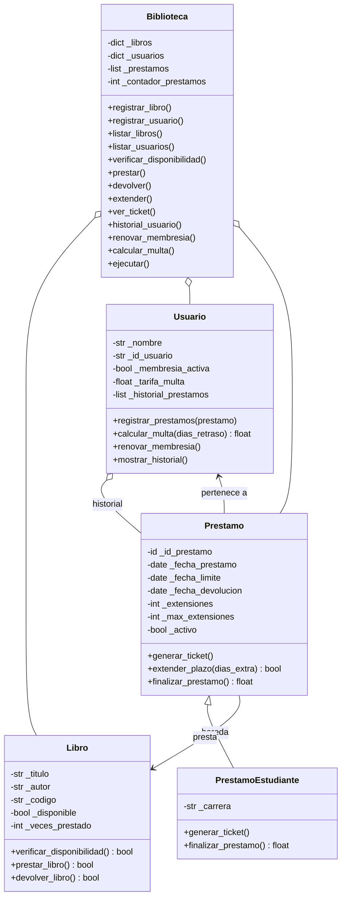

# Informe: Sistema de gestión de biblioteca

Evaluación Grupal 1 – Lenguaje de Programación II (2026-2)

## 1. Escenario simulado

Se simula una biblioteca pequeña. Hay **libros** que pueden estar disponibles o prestados, **usuarios** con una membresía y una tarifa de multa por día de retraso, y **préstamos** que relacionan a un usuario con un libro durante un plazo de días. Los préstamos pueden ser normales o de **estudiante**, con más días de plazo, más extensiones y multa reducida a la mitad. Todo se maneja desde un menú interactivo en consola.

Se aplican los conceptos de POO pedidos: clases, objetos, constructores, métodos, encapsulamiento (atributos privados con getters en todas las clases), herencia (`PrestamoEstudiante` hereda de `Prestamo`) y relaciones entre objetos. Los datos se guardan en listas y diccionarios.

El sistema está completo en un solo archivo, `menu1.py`, que se ejecuta con `python menu1.py`.

## Diagrama de clases



## 2. Clases, atributos y métodos

### 2.1 `Libro`
Representa un libro y controla su disponibilidad.

**Atributos privados:** `_titulo`, `_autor`, `_codigo` (único), `_disponible` y `_veces_prestado`.
El constructor valida que título, autor y código no estén vacíos. Se leen con `get_titulo()`, `get_autor()`, `get_codigo()` y `get_veces_prestado()`.

| Método | Función |
|---|---|
| `verificar_disponibilidad()` | Devuelve `True` si el libro puede prestarse. |
| `prestar_libro()` | Lo marca como prestado y suma 1 al contador. Devuelve `False` si ya estaba prestado. |
| `devolver_libro()` | Lo marca como disponible. Devuelve `False` si ya estaba en la biblioteca. |

### 2.2 `Usuario`
Representa a un socio de la biblioteca.

**Atributos privados:** `_nombre`, `_id_usuario`, `_membresia_activa` (inicia en `True`), `_tarifa_multa` (por defecto 2.5 por día) y `_historial_prestamos` (lista de objetos `Prestamo`).
Se leen con `get_nombre()`, `get_id()` e `is_membresia_activa()`.

| Método | Función |
|---|---|
| `registrar_prestamos(prestamo)` | Agrega un `Prestamo` al historial. |
| `calcular_multa(dias_retraso)` | Devuelve `dias_retraso * tarifa`, o 0 si no hay retraso. |
| `renovar_membresia()` | Vuelve a activar la membresía. |
| `mostrar_historial()` | Muestra cuántos préstamos ha hecho el usuario. |

### 2.3 `Prestamo`
Transacción que une un `Usuario` con un `Libro` durante un plazo. Es el módulo de control y gestión.

**Atributos privados:** `_id_prestamo`, `_usuario`, `_libro`, `_fecha_prestamo` (la fecha de hoy al crearlo), `_dias_plazo` (7 por defecto), `_fecha_limite`, `_fecha_devolucion` (`None` hasta devolver), `_extensiones` (contador), `_max_extensiones` (2) y `_activo`.
Se leen con `get_id()`, `get_usuario()`, `get_libro()`, `get_fecha_limite()`, `get_dias_plazo()` e `is_activo()`.

| Método | Función |
|---|---|
| `generar_ticket()` | Imprime el comprobante: número, usuario, libro, fechas y estado. |
| `extender_plazo(dias_extra)` | Suma días a la fecha límite y aumenta `_extensiones`. Devuelve `False` si el préstamo terminó, si los días no son positivos o si ya se alcanzó `_max_extensiones`. |
| `finalizar_prestamo()` | Toma la fecha de hoy como devolución, cierra el préstamo, devuelve el libro y calcula la multa por los días de retraso con `Usuario.calcular_multa()`. Devuelve el monto. |

### 2.4 `PrestamoEstudiante` – herencia
Subclase de `Prestamo` para estudiantes. Sobrescribe tres cosas:

- **Constructor:** usa 14 días de plazo (en lugar de 7) y `_max_extensiones = 3`. Agrega el atributo `_carrera`.
- **`generar_ticket()`:** reutiliza el ticket de la clase padre con `super()` y añade el tipo de préstamo y la carrera.
- **`finalizar_prestamo()`:** llama a `super()` y, si hay multa, la reduce a la mitad.

### 2.5 `Biblioteca`
Clase que coordina el sistema y contiene el menú.

**Atributos privados:** `_libros` (diccionario código → `Libro`), `_usuarios` (diccionario ID → `Usuario`), `_prestamos` (lista de `Prestamo`) y `_contador_prestamos`, que genera los IDs `P001`, `P002`, etc.
El método `ejecutar()` muestra el menú en un bucle y llama al método correspondiente a cada opción. Los diccionarios permiten buscar libros y usuarios por código o ID y evitan duplicados.

## 3. Flujo de un préstamo

1. Se registran un libro y un usuario (opciones 1 y 2).
2. **Prestar (6):** se comprueba que el usuario exista y tenga la membresía activa. `Libro.prestar_libro()` valida la disponibilidad. Luego se pregunta si el usuario es estudiante: si lo es, se crea un `PrestamoEstudiante` (y se pide la carrera); si no, un `Prestamo`. El préstamo se guarda en el historial del usuario y en la lista de la biblioteca, y se imprime el ticket.
3. **Extender (8):** `extender_plazo()` amplía la fecha límite. Un préstamo normal admite 2 extensiones y uno de estudiante, 3.
4. **Ver ticket (9):** `generar_ticket()` imprime el comprobante en cualquier momento.
5. **Devolver (7):** `finalizar_prestamo()` usa la fecha real. Si hay retraso, calcula la multa con la tarifa del usuario (y la mitad si es estudiante) y libera el libro.

## 4. Menú interactivo

| Opción | Acción |
|---|---|
| 1 / 2 | Registrar libro / usuario |
| 3 / 4 | Listar libros / usuarios |
| 5 | Verificar disponibilidad de un libro |
| 6 | Prestar libro (normal o de estudiante) |
| 7 | Devolver libro (finalizar préstamo) |
| 8 | Extender plazo de un préstamo |
| 9 | Ver ticket de un préstamo |
| 10 | Historial de un usuario |
| 11 | Calcular multa de un número de días de retraso |
| 12 | Renovar membresía |
| 0 | Salir |

El menú valida las entradas: IDs y códigos duplicados, elementos inexistentes, números no enteros, opciones fuera de rango y usuarios con membresía inactiva. Las opciones 7 y 8 solo muestran préstamos activos.

## 5. Ejecución de prueba

Se registran los libros *Don Quijote* (L1) e *Ilíada* (L2) y los usuarios Ana (U1) y Luis (U2). Luego:

1. Ana toma *Don Quijote* como préstamo normal. Recibe el préstamo P001 con vencimiento a 7 días.
2. Luis toma *Ilíada* como estudiante de Ingeniería. Recibe el préstamo P002 con 14 días.
3. Se extiende P001 dos veces (+3 días y +1 día). El vencimiento pasa del 24 al 27 y luego al 28 de octubre de 2026. Un tercer intento es rechazado, porque un préstamo normal admite 2 extensiones.
4. Se consulta el ticket de P002.
5. Se devuelven ambos libros. Como la devolución ocurre el mismo día, no hay multa.

Fragmento del ticket de P002:

```
==============================
      TICKET DE PRESTAMO
==============================
N° de prestamo: P002
Usuario: Luis
Libro: Ilíada
Fecha de prestamo: 2026-10-17
Fecha limite: 2026-10-31
Estado: Activo
==============================
Tipo: Prestamo de estudiante
Carrera: Ingeniería
```

**Prueba de multas.** El menú no puede esperar días reales, así que las multas se comprobaron con un script aparte que retrasa la fecha límite 6 días:

- Préstamo normal: 6 × S/ 2.50 = **S/ 15.00**.
- Préstamo de estudiante: 15.00 / 2 = **S/ 7.50**.

## 6. Conclusión

El sistema usa 5 clases (una de ellas es subclase de otra), con constructores, métodos propios, atributos privados con getters, listas y diccionarios, y un menú interactivo en consola. Todo está en `menu1.py`. Cumple los requisitos mínimos y el requisito opcional de la evaluación.
